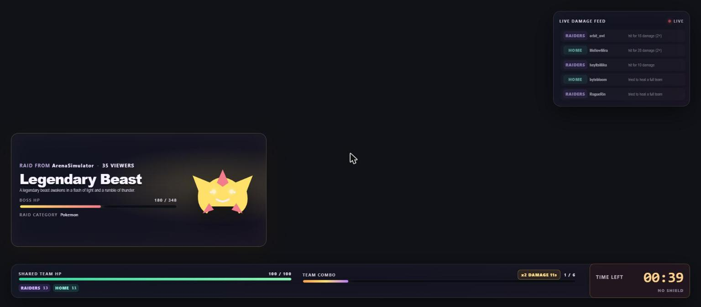
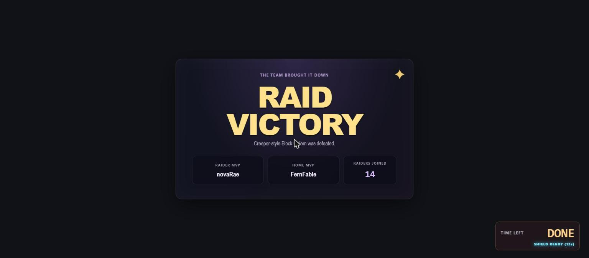
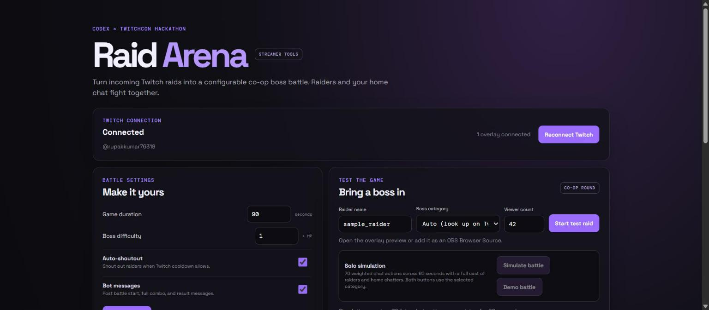

# Raid Arena

Raid Arena turns incoming Twitch raids into a cooperative boss battle for an OBS browser-source overlay. Raiders and the channel's existing chat work together for a configurable game round. Boss art uses inline SVG and CSS; it loads no external image assets.

## Built with OpenAI Codex

The whole project was written in a single Codex thread. Codex scaffolded the Twitch OAuth and EventSub plumbing, game engine, overlay, dashboard, retention tracking, and simulation, then iterated through four test-and-fix rounds covering boss balance, the stream-safe compact overlay, a realistic simulation reaching 9/10 boss kills in headless runs, and category-themed bosses.

## Screenshots


*Compact overlay mid-battle: Pokemon-themed Legendary Beast, live damage feed, shared team HP, combo meter and countdown.*


*RAID VICTORY finish card showing both team MVPs.*


*Streamer dashboard with settings, simulation controls, and raid history.*

## Requirements

- Windows 10 or newer
- Node.js 20 or newer (npm is included)
- A Twitch broadcaster account and a Twitch Developer application

## 1. Create a Twitch app

1. Sign in at [dev.twitch.tv/console](https://dev.twitch.tv/console) and select **Register Your Application**.
2. Name it (for example, `Raid Arena`) and choose **Application Integration**.
3. Set **OAuth Redirect URLs** to exactly `http://localhost:3000`.
4. Create the app, open **Manage**, and copy the Client ID and Client Secret.

Raid Arena requests these broadcaster scopes:

- `moderator:read:followers`
- `channel:read:subscriptions`
- `user:read:chat`
- `user:write:chat`
- `moderator:manage:shoutouts`

Chat scopes support EventSub chat and the game's short bot updates. The shoutout scope is used by auto-shoutout. Twitch's Send a Shoutout endpoint has a two-minute broadcaster cooldown and a one-hour same-target cooldown. See the [Twitch API reference](https://dev.twitch.tv/docs/api/reference).

## 2. Configure and start

Open PowerShell in the project folder:

```powershell
Copy-Item .env.example .env
notepad .env
```

Enter your app credentials and keep these local values:

```dotenv
TWITCH_CLIENT_ID=your_client_id
TWITCH_CLIENT_SECRET=your_client_secret
TWITCH_REDIRECT_URI=http://localhost:3000
PORT=3000
TOKEN_FILE=server/data/tokens.json
```

Install and start the server:

```powershell
npm.cmd install
npm.cmd start
```

Open [http://localhost:3000](http://localhost:3000), click **Connect Twitch**, and authorize the broadcaster account. OAuth tokens, settings, and raid records are stored under `server/data/`. Those files and `.env` are ignored by Git.

## 3. Overlay

In OBS, add a **Browser Source** with URL `http://localhost:3000/overlay` and set its size to your canvas (1920 x 1080 is a good fit). The default stream-safe layout puts the boss card bottom-left, the team bars and countdown in a bottom strip, and the damage feed top-right, leaving the centre open. The dashboard preview uses the original large layout. To open it directly, use `http://localhost:3000/overlay?layout=full`.

For direct browser demos or recordings, add `?bg=dark` for a solid `#101218` background; it can be combined with `layout=full` as `?layout=full&bg=dark`. The default background remains transparent for OBS.

The idle overlay shows a small `Raid Arena ready` badge, which fades after five seconds. A raid brings in the boss HUD and game effects. The finish screen can use the centre for eight seconds, then fades away.

## Demo in 60 seconds

1. Start the server with `npm.cmd start` and open [http://localhost:3000](http://localhost:3000).
2. Connect the broadcaster account if it is not connected already.
3. In **Test the Game**, choose a boss category from the dropdown (or leave **Auto** to look up the test raider on Twitch).
4. Click **Simulate battle** to run the 60-second, 70-action round with that category, or click **Demo battle** for the same battle labeled `ArenaDemo`.

Use **Start test raid** to preview just the selected boss without starting the simulated chat round.

## Game rules

- Boss HP is `40 + 3 x raid viewers`, clamped to 60-600, then adjusted by the saved difficulty multiplier and clamped again to 60-600.
- Bosses attack every 10 seconds. They remove 12 shared team HP while above half health and 8 HP at or below half. The team starts at 100 HP. A `!shield` blocks the next boss attack or expires after 12 seconds, whichever comes first.
- The default round lasts 90 seconds. The team loses if shared team HP reaches zero. When time expires, the team earns a last-stand victory if boss HP is below 25%; otherwise it loses.
- Each user can use one game command every four seconds.
- `!attack` deals 6-14 damage. Attacks alternating between RAIDERS and HOME fill the combo meter; a full meter doubles attack damage for 12 seconds. Consecutive attacks from one team break the combo.
- `!rally` charges the other team: its next alternating attack adds combo progress. `!heal` restores 20 shared team HP, up to 100.
- The user's first chat message in the rolling 30-minute channel history determines their team. A first message after the raid makes them a RAIDER; everyone with an earlier message is HOME.
- The finish screen shows the result, each team's MVP, and the distinct raiders who joined the battle.

Boss themes are selected by category substring (Minecraft, Just Chatting, tactical shooters, Fortnite, Pokemon, Music, IRL/Travel, Science, or a Void Kaiju fallback). The server sends the theme and the overlay draws it with inline SVG.

## Streamer tools and settings

Dashboard settings are saved in `server/data/settings.json` and apply to the next raid:

- **Game duration:** 30-180 seconds; default 90.
- **Boss difficulty:** 0.5x-3.0x HP; default 1.0x.
- **Auto-shoutout:** enabled by default. The server honors Twitch cooldowns and logs failures without stopping the battle.
- **Bot messages:** enabled by default. The broadcaster posts a command guide at raid start, a message when combo fills, and the result at the end.

Successful broadcaster chat posts and shoutouts are logged with a clear success line. Failed Helix requests log their HTTP status and Twitch response body.

Advanced boss attack settings are stored in the same JSON file and can be edited there while the server is stopped. Defaults are:

```json
{
  "bossAttackIntervalSeconds": 10,
  "bossAttackDamageAbove50Percent": 12,
  "bossAttackDamageAtOrBelow50Percent": 8
}
```

The interval accepts 1-120 seconds; each damage value accepts 1-100. Settings are validated at startup.

Every raid is logged to `server/data/raids.json`. Raider retention samples count distinct raiders active in the 60-second window at 1, 5, and 10 minutes. The summary compares the 10-minute active users from the first-minute cohort against that cohort's first-minute count, averaged across completed samples. Unfinished encounters are marked `interrupted` at startup.

## Test without a real raid

1. Open `/overlay` in a browser tab or add it to OBS.
2. On the dashboard, use **Start test raid** to start one synthetic raid.
3. Use **Simulate battle** to start a 60-second battle for a 35-viewer `ArenaSimulator` raid. It sends 70 fake actions over the round, weighted 60% `!attack`, 15% `!heal`, 15% `!shield`, and 10% `!rally`. RAIDERS and HOME alternate on every action. Actions rotate across 14 raider and 10 home identities, each with a stable user ID, so every action clears the four-second cooldown. Twitch shoutouts are skipped. The simulator uses a fixed 2.4x boss HP multiplier; this does not change the saved live-game difficulty.

To run ten seeded headless simulations without waiting ten real minutes:

```powershell
node scripts/sim-check.js
```

The script uses the game's optional `timeScale: 10` clock and prints each outcome plus separate totals for real boss kills, last-stands, and fallen rounds.

You can inject an individual fake chat message during an active game:

```powershell
Invoke-RestMethod -Method Post -Uri http://localhost:3000/test/chat `
  -ContentType 'application/json' `
  -Body '{"user":"NewRaider","message":"!attack","team":"RAIDERS"}'
```

The `team` field is optional; it can be `RAIDERS` or `HOME`. Without it, normal 30-minute chat-history classification is used. Non-command messages also add a participant and retention activity.

Start a test raid directly if needed:

```powershell
Invoke-RestMethod -Method Post -Uri http://localhost:3000/test/raid `
  -ContentType 'application/json' `
  -Body '{"raiderName":"sample_raider","viewerCount":42,"category":"Minecraft"}'
```

Leave out `category` (or send `"category":""`) to use automatic Twitch category lookup instead.

The dashboard updates raid history and retention samples as they are recorded. A not-yet-due retention sample shows as pending with the time remaining.

For a test raid API call, `category` is optional. Omit it or send an empty string for automatic Twitch lookup; set it to a category such as `Minecraft` or `Science & Technology` to select a theme directly.

## Project layout

```text
server/       Express routes, Twitch OAuth/Helix, game state, themes, retention, settings
overlay/      Transparent OBS HUD and CSS/SVG boss art
dashboard/    Streamer settings, test tools, raid history, retention summary
scripts/      Headless game simulation checks
```

## How it works

```text
Twitch EventSub (raid + chat)
        -> server/game.js
        -> WebSocket (/ws/overlay)
        -> overlay/ (OBS Browser Source)

server/retention.js
        -> server/data/raids.json
        -> dashboard/ (history + retention summary)
```

Licensed under the [MIT License](LICENSE).
